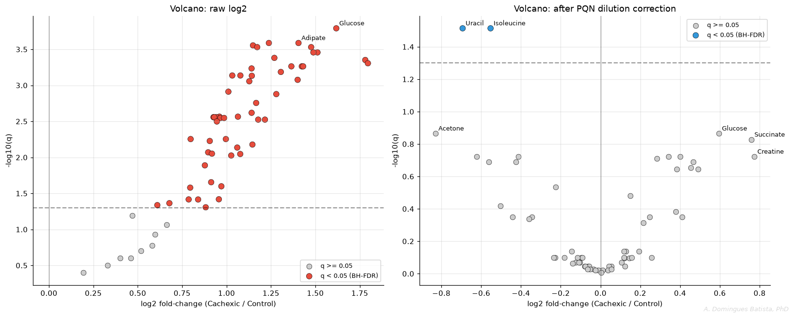
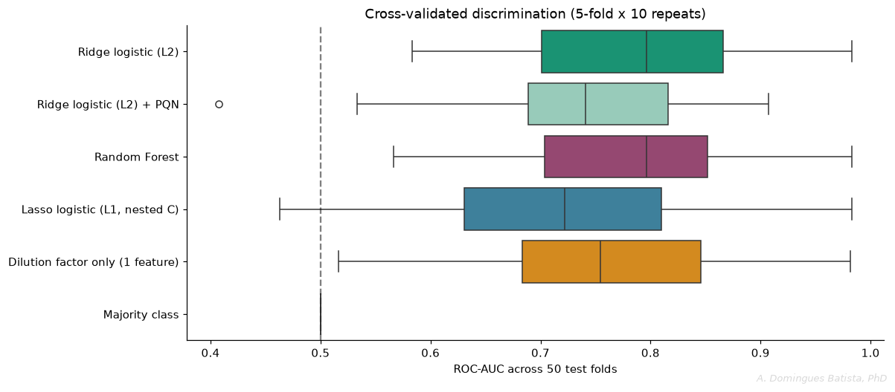
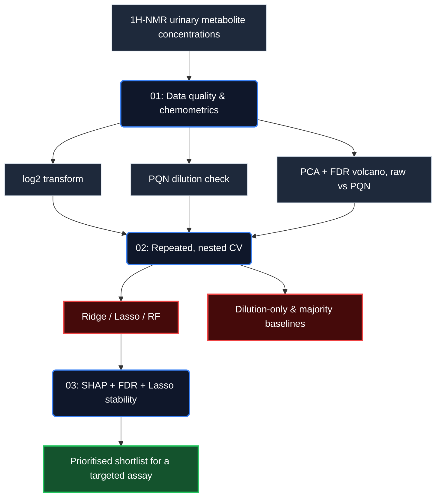
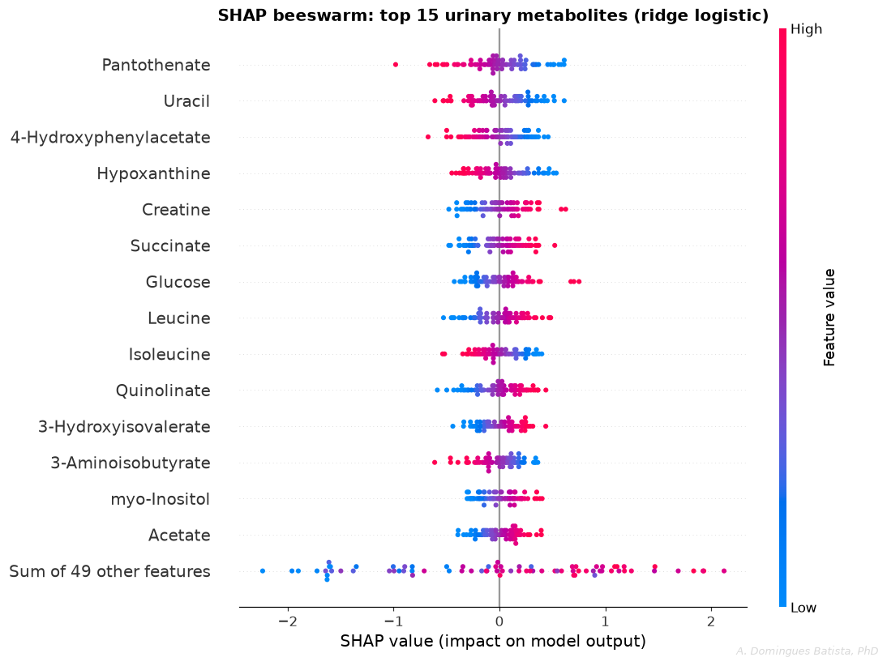

# Urinary Metabolomics Biomarker Discovery for Cancer Cachexia
## Explainable ML, with the chemometric due diligence that usually gets skipped

[](https://www.python.org/)
[](https://github.com/shap/shap)
[](https://scikit-learn.org/)

---

## The question

Cachexia (cancer-associated muscle wasting) is usually recognised only after substantial muscle has been lost. Can a **urine metabolite profile** flag it, and which metabolites are worth building a targeted assay for?

## Dataset

Real, public ¹H-NMR urinary metabolomics data:
- **77 cancer patients**: 47 cachexic, 30 non-cachexic controls
- **63 quantified metabolites** (concentrations, µM), no missing values
- Eisner R. *et al.* (2011) "Learning to predict cancer-associated skeletal muscle wasting from ¹H-NMR profiles of urinary metabolites", *Metabolomics* 7, 25–34. [doi:10.1007/s11306-010-0232-9](https://doi.org/10.1007/s11306-010-0232-9). Distributed as an example dataset by [MetaboAnalyst](https://www.metaboanalyst.ca/).

The CSV is stored in [`../../data/human_cachexia.csv`](../../data/human_cachexia.csv). Notebook 01 downloads it from MetaboAnalyst automatically if it is missing.

---

## Key results

| | Result |
|---|---|
| Best model (ridge logistic, 5-fold × 10 repeated CV) | **ROC-AUC 0.78 ± 0.10**, balanced accuracy 0.75 ± 0.10 |
| Urine dilution factor alone (1 feature) | ROC-AUC 0.75 ± 0.11 |
| Same model after PQN dilution correction | ROC-AUC 0.74 ± 0.10 |
| Sparse Lasso (nested CV) | ROC-AUC 0.71 ± 0.12, ~8 metabolites per fold |
| FDR-significant metabolites (raw → PQN-corrected) | **54 → 2** (uracil, isoleucine) |
| SHAP shortlist for a targeted assay | uracil, isoleucine, creatine, glucose, leucine, quinolinate, 3-hydroxyisovalerate, myo-inositol, acetate |

### The main finding: check the dilution factor first

Cachexic patients' urine is **globally about 2× more concentrated** (PQN dilution factor 1.53 vs 0.79, Mann–Whitney p ≈ 2 × 10⁻⁴). As a result:

- Without normalisation, 54 of 63 metabolites look significantly "up" in cachexia. That uniform shift is the fingerprint of a dilution difference, not 54 independent biomarkers.
- After probabilistic quotient normalisation (PQN), only **uracil** and **isoleucine** remain significant, and both are relatively *lower* in cachexia.
- A one-number model (overall urine concentration) reaches AUC 0.75. The full metabolite profile adds a little on top (0.78).

Whether the concentration difference is biology or pre-analytical (hydration, collection time) can't be resolved from these data. A naive ML pipeline would report it as a large biomarker panel.





---

## Pipeline



1. **`01_chemometric_eda.ipynb`**: QC, log₂ transform, PQN dilution analysis, PCA, Welch t-tests with Benjamini–Hochberg FDR before and after dilution correction.
2. **`02_biomarker_ml.ipynb`**: repeated stratified 5-fold CV (50 test folds). All preprocessing sits inside a scikit-learn `Pipeline`, and the Lasso strength is tuned by an inner CV. Models are compared with majority-class and dilution-only baselines. Includes Lasso selection stability.
3. **`03_shap_interpretation.ipynb`**: `shap.LinearExplainer` on the best model, a beeswarm plot, a single-patient waterfall, and a ranking that combines SHAP, FDR q-values (raw and PQN) and Lasso selection frequency.



**How to read the SHAP plot.** Several top features (pantothenate, uracil) have *negative* weights, even though their raw levels are higher in cachexia. Because every metabolite rises with urine concentration, the model learns contrasts: uracil that is low *relative to everything else* points towards cachexia. This agrees with the PQN analysis.

---

## Limitations

- n = 77 from a single study. Fold-to-fold AUC varies by about ±0.10, which is the honest uncertainty.
- The dominant signal, global urine concentration, may be biological or pre-analytical.
- Correlated metabolites share credit in SHAP, and the Lasso picks among them unstably (about 8 per fold, only 7 selected in ≥ 50 % of folds).
- The shortlist is a prioritisation for validation, not evidence of diagnostic value.

**Next experimental steps:** standardise urine collection and record specific gravity or osmolality, run a targeted absolute-quantification assay for the shortlist, then validate in an independent cohort with a pre-registered threshold.

---

## Files

```
metabolomics-biomarker-discovery/
├── 01_chemometric_eda.ipynb      # QC, dilution analysis, PCA, FDR volcano plots
├── 02_biomarker_ml.ipynb         # Repeated nested CV, baselines, Lasso stability
├── 03_shap_interpretation.ipynb  # SHAP + biomarker ranking
├── figures/                      # Figures saved by the notebooks
├── univariate_results.csv        # Notebook 01 output
├── model_comparison.csv          # Notebook 02 output
├── lasso_stability.csv           # Notebook 02 output
├── biomarker_ranking.csv         # Notebook 03 output
└── requirements.txt
```

## Running it

```bash
cd featured/metabolomics-biomarker-discovery
python -m venv .venv && source .venv/bin/activate
pip install -r requirements.txt
jupyter notebook   # run 01 → 02 → 03 (each takes under 2 minutes)
```

---

## Domain context

From 10+ years of analytical chemistry: metabolomics data is not generic tabular data. Urine in particular varies several-fold in concentration with hydration, so a dilution check (PQN, creatinine or osmolality) belongs **before** any statistics or ML. In this dataset, skipping it would turn one global effect into dozens of "biomarkers".

## References

- Eisner R. *et al.* (2011), *Metabolomics* 7, 25–34: [doi:10.1007/s11306-010-0232-9](https://doi.org/10.1007/s11306-010-0232-9)
- Dieterle F. *et al.* (2006), probabilistic quotient normalisation, *Anal. Chem.* 78, 4281–4290: [doi:10.1021/ac051632c](https://doi.org/10.1021/ac051632c)
- Lundberg S. & Lee S.-I. (2017), SHAP: [arXiv:1705.07874](https://arxiv.org/abs/1705.07874)
- [MetaboAnalyst](https://www.metaboanalyst.ca/) · [HMDB](https://hmdb.ca/)
