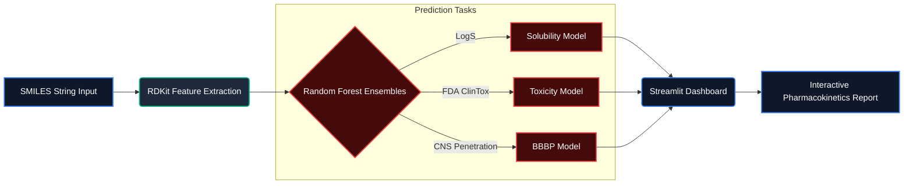

# 🧪 ToxPred AI: In-Silico ADMET Screening Platform


**ToxPred** is a Machine Learning application designed to accelerate early-stage drug discovery protocols. It predicts critical physicochemical and biological properties of small molecules before physical synthesis, enabling computational chemists to filter out non-viable candidates early in the pipeline.

## 🚀 Key Features

* **💧 Solubility Prediction (LogS):** Random Forest regressor on the **Delaney (ESOL)** dataset using Morgan fingerprints plus 10 physicochemical descriptors (logP, TPSA, MW, …).
* **☠️ Toxicity Screening:** Binary classifier trained on the **ClinTox (FDA)** dataset to flag structural motifs associated with clinical trial failures.
* **🧠 Blood-Brain Barrier (BBB) Permeability:** Classifier trained on **BBBP** data to predict CNS penetration—a critical assay for neuropharmacology.
* **💊 Drug-Likeness:** Automatic calculation of **Lipinski’s Rule of Five** to assess oral bioavailability.
* **🧬 Structural Intelligence:** Uses **Morgan Fingerprints (ECFP4)** to analyze chemical substructures (2,048-bit vectors) for the classifiers; solubility combines them with descriptors.

## 📊 Model Performance

All numbers are **5-fold scaffold-split cross-validation** (mean ± std): molecules are grouped by Bemis–Murcko scaffold so every test fold contains chemotypes the model has never seen. This is harder and more realistic than a random split. Reproduce with `python evaluate.py`.

| Model | Dataset | Random Forest | Simple baseline | Trivial baseline |
| :--- | :--- | :--- | :--- | :--- |
| **Solubility** (LogS) | ESOL, n = 1,128 | R² 0.82 ± 0.04 · RMSE 0.84 | Ridge: R² 0.78 | Mean: R² −0.21 |
| **Toxicity** | ClinTox, n = 1,480 (7.6 % toxic) | ROC-AUC 0.84 ± 0.05 · PR-AUC 0.40 | LogReg: ROC-AUC 0.83 · PR-AUC 0.43 | Majority: PR-AUC 0.08 |
| **BBB Permeability** | BBBP, n = 2,039 | ROC-AUC 0.90 ± 0.02 · Bal. Acc 0.79 | LogReg: ROC-AUC 0.88 | Majority: ROC-AUC 0.50 |

**Why not accuracy?** ClinTox is highly imbalanced: a model that always predicts "non-toxic" scores 92 % accuracy while being useless. ROC-AUC and PR-AUC (vs. a 0.08 chance level) are the meaningful metrics.

**Honest takeaways**
- Fingerprints alone generalise poorly for solubility on new scaffolds (R² ≈ 0.1); adding physicochemical descriptors lifts it to 0.82.
- On toxicity the Random Forest is on par with logistic regression, so the gain comes from the representation, not model complexity.
- ClinTox labels *clinical-trial* toxicity failures (many are approved oncology drugs), not general toxicity — predictions outside drug-like chemical space (e.g. pesticides) should be treated with caution.

## 🛠️ Tech Stack

* **Language:** Python
* **Cheminformatics:** RDKit (Molecular Descriptor Calculation & Fingerprinting)
* **Machine Learning:** Scikit-Learn (Random Forest Ensemble)
* **Web Framework:** Streamlit
* **Data Source:** DeepChem & PubChem PUG REST API

## 📦 Deployment Architecture



Model files (`*.pkl`, ~18 MB) are **not stored in git**. The app trains them automatically on first launch (about 1–2 minutes), or you can build them up front:
```bash
python step_models.py   # downloads DeepChem datasets and trains the 3 models
python evaluate.py      # scaffold-split benchmark → evaluation_results.csv
```

## 💻 Installation & Usage

1.  **Clone the repository:**
    ```bash
    git clone https://github.com/alexdbatista/data-science-portfolio.git
    cd data-science-portfolio/featured/toxpred-explainable
    ```

2.  **Install dependencies:**
    ```bash
    pip install -r requirements.txt
    ```

3.  **Run the App** (models are trained automatically on first launch):
    ```bash
    streamlit run toxpred_app.py
    ```

4.  **(Optional) Pre-train models and run the benchmark:**
    ```bash
    python step_models.py
    python evaluate.py
    ```

## 🧪 Example Use Cases

* **Caffeine:** Predicted **BBB permeable** (93 %), consistent with its well-known CNS stimulant activity.
* **Dopamine:** Predicted **BBB impermeable** (5 %), correctly identifying the pharmacokinetic barrier that necessitates L-DOPA delivery in Parkinson's disease.
* **Aspirin (a dataset caveat):** Flagged as high clinical-toxicity risk because ClinTox itself labels aspirin as a clinical-trial toxicity failure. A good reminder that a model can only be as reliable as its labels.
